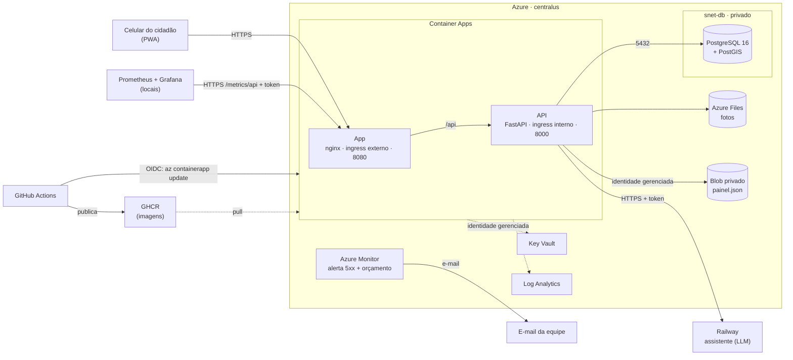

# Arquitetura

Este documento descreve a nuvem do Passo Seguro **como ela está hoje**, segundo o Terraform em [`infra/`](../../infra/README.md), o [`ci.yml`](../../.github/workflows/ci.yml) e a pasta [`observabilidade/`](../../observabilidade/README.md). O que não existe na nuvem está marcado como tal.

Tudo roda na Azure, em `centralus`, no resource group `rg-passoseguro-prod`. A exceção é o assistente (LLM), que roda no Railway, fora da Azure.

## Diagrama



A imagem [`arquitetura.png`](./arquitetura.png) é o mesmo diagrama, para o PDF. A fonte é o arquivo [`arquitetura.mmd`](./arquitetura.mmd). Para gerar o PNG de novo (só precisa de Docker; o Chromium já vem na imagem):

```bash
echo '{"executablePath": "/usr/bin/chromium-browser", "args": ["--no-sandbox"]}' > /tmp/puppeteer.json
MSYS_NO_PATHCONV=1 docker run --rm \
  -v "$PWD/docs/devops:/data" -v /tmp/puppeteer.json:/puppeteer.json:ro \
  minlag/mermaid-cli:11.4.2 \
  -i /data/arquitetura.mmd -o /data/arquitetura.png -p /puppeteer.json -b white -s 2 -w 1600
```

### Como ler o diagrama

- **Linha cheia:** tráfego de aplicação. **Linha pontilhada:** apoio (segredos, logs, pull de imagem).
- **O navegador só fala com o app.** O nginx repassa `/api/*` para a API pelo nome interno `http://ca-passoseguro-api`. A API não tem endereço na internet.
- **A raspagem de métricas também entra pelo app.** O Prometheus chama `https://<app>/metrics/api` com `Authorization: Bearer`. O nginx confere o token e repassa para `/metrics` da API, que confere de novo. `/api/metrics` responde 404.
- **O deploy não roda Terraform.** O pipeline publica a imagem no GHCR e troca a imagem de cada Container App com `az containerapp update`, logado por OIDC. O `terraform apply` é sempre manual.
- **Alertas:** o Azure Monitor avisa por e-mail (mais de 5 respostas 5xx em 5 minutos no app; orçamento em 50%, 80% e 100%). O Grafana local avisa no Discord. O Grafana não aparece no diagrama como destino porque roda só quando a equipe liga.

## Componentes

| Componente | Serviço Azure | Imagem ou SKU | Porta interna | Acesso |
|---|---|---|---|---|
| App (PWA + nginx) | Container Apps (perfil Consumption) | `ghcr.io/passo-seguro/passo-seguro-app`, base `nginxinc/nginx-unprivileged:1.31-alpine`; 0,25 vCPU, 0,5 GiB; até 2 réplicas | 8080 | **Público** (ingress externo; HTTP redireciona para HTTPS) |
| API (FastAPI) | Container Apps (perfil Consumption) | `ghcr.io/passo-seguro/passo-seguro-api`, base `python:3.12-slim`; 0,5 vCPU, 1 GiB; até 2 réplicas | 8000 | **Privado** (ingress interno; só o app a chama) |
| Banco | PostgreSQL Flexible Server 16 + PostGIS | `B_Standard_B1ms`, 32 GB, backup de 7 dias, sem redundância geográfica | 5432 | **Privado** (`snet-db`, sem endereço público; NSG só aceita a `snet-aca`) |
| Fotos | Azure Files (conta Standard LRS) | share `fotos`, cota de 5 GB, montado na API em `/data/fotos` | — | Privado por chave da conta; o firewall da conta está aberto (veja [riscos aceitos](../../infra/README.md#riscos-aceitos)) |
| Painel de prioridades | Blob Storage (mesma conta) | container `painel`, arquivo `painel.json`; sem acesso anônimo | — | Privado: a API lê com identidade gerenciada, sem SAS e sem chave |
| Segredos | Key Vault | SKU `standard`, RBAC; 7 segredos com validade até 30/06/2027 | — | Endpoint público, exige Entra ID e papel (risco aceito) |
| Identidades | Managed Identity | `id-passoseguro-apps` (lê segredos e o container `painel`) e `id-passoseguro-github` (deploy, OIDC) | — | — |
| Rede | VNet `10.20.0.0/16` | `snet-aca` (/27) e `snet-db` (/28), cada uma com um NSG | — | NSG do app: só 80 e 443 da internet; nenhuma porta de administração |
| Logs | Log Analytics | `PerGB2018`, retenção de 30 dias, teto de 0,15 GB/dia | — | Privado |
| Alertas | Azure Monitor | alerta de 5xx no app, grupo de ação por e-mail; orçamento mensal de US$ 10 | — | — |
| Imagens | GHCR (GitHub) | pacotes `passo-seguro-api` e `passo-seguro-app`, tags `:<sha>` e `:latest` | — | Públicos (o Container Apps puxa sem credencial) |
| Pipeline | GitHub Actions | `ci.yml`: segredos, SAST, IaC, testes, build com Trivy e deploy | — | — |
| Assistente (LLM) | **Railway** (fora da Azure) | não é gerenciado por este repositório; a API chama `ASSISTENTE_URL` por HTTPS com `Authorization: Bearer` | — | Público, protegido por token |
| Visão (YOLO) | **Não implantado** | o Terraform não entrega `VISAO_URL`; sem ele o relato nasce sem categoria | — | — |
| Observabilidade | Prometheus 3.15 + Grafana 13 em Docker, **no notebook** | portas só em `127.0.0.1`; raspagem de 30 s | 9090 e 3000 | Local |

Valores de réplicas: o Terraform aceita de 0 a 2 de mínimo e o padrão é 0. Com 0, o app e a API escalam a zero, e a primeira requisição depois de um tempo parado tem partida a frio. Para a demonstração, use `min_replicas = 1` (veja [`infra/README.md`](../../infra/README.md)).

## `/fotos/*` é público por URL não adivinhável

A API serve as fotos em `/fotos/<chave>`. O app as expõe em `/api/fotos/<chave>`. **Não há autenticação nessa rota.** Quem tem a URL vê a foto.

A proteção é a própria URL: a chave é `relatos/<uuid4>.<jpg|png>`, com um UUID aleatório gerado no servidor (`uuid4()`), então não dá para adivinhar. Duas coisas reduzem a exposição:

- A URL da foto **não** sai nas rotas públicas do mapa. `GET /relatos/proximos` devolve só localização arredondada, categoria, status, prioridade e confirmações.
- A URL sai em `GET /meus-relatos` (só para o autor, pelo `X-Autor-Id`) e em `GET /relatos` (só com o token de serviço).

O que isso **não** garante: a URL não expira e não é revogável. Quem a recebe por qualquer meio (print, compartilhamento) mantém o acesso. Por isso é um **risco aceito** no MVP, registrado na [tabela de riscos aceitos](../../infra/README.md#riscos-aceitos) do `infra/README.md`. A evolução está lá: URL assinada com validade curta, ou rota autenticada. O desfoque de rostos e placas **ainda não existe** (veja [`lgpd.md`](./lgpd.md)).

## Por que não uma VM

Avaliamos rodar tudo numa VM (IaaS) com Docker Compose. Não é possível dentro do orçamento:

- **A série B (VMs baratas, "burstable") não é oferecida à nossa assinatura em `eastus`.**
- **O único tamanho de 8 GB disponível é o `Standard_D2as_v4`**, que custaria **cerca de US$ 70 por mês** (valor aproximado da avaliação da equipe; confira na calculadora de preços da Azure antes de citar em outro lugar).
- O orçamento do projeto é de **US$ 10 por mês** (`budget_amount` no Terraform).

Os serviços gerenciados também tiram do nosso lado o sistema operacional, os patches e o runtime de containers. Veja a comparação em [`responsabilidade-compartilhada.md`](./responsabilidade-compartilhada.md). O custo da arquitetura atual está em [`custo.md`](./custo.md).

A restrição de regiões da assinatura também pesa: só `chilecentral`, `eastus`, `southcentralus`, `centralus` e `canadacentral` são permitidas, e o PostgreSQL Flexible Server está restrito em `eastus` e `southcentralus`. Por isso tudo roda em `centralus`.
